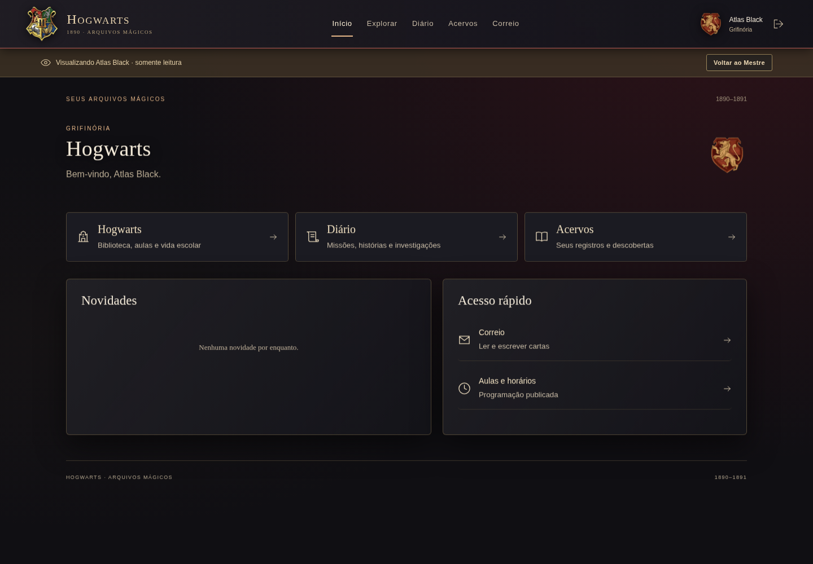
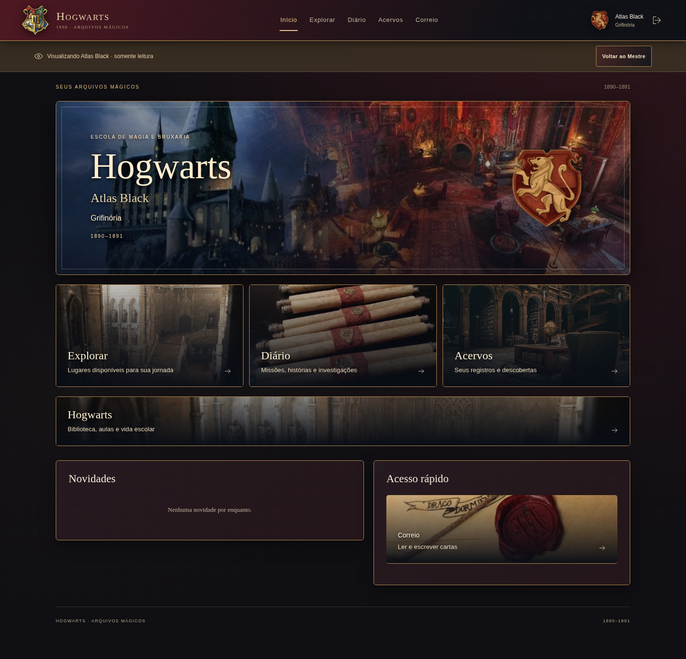
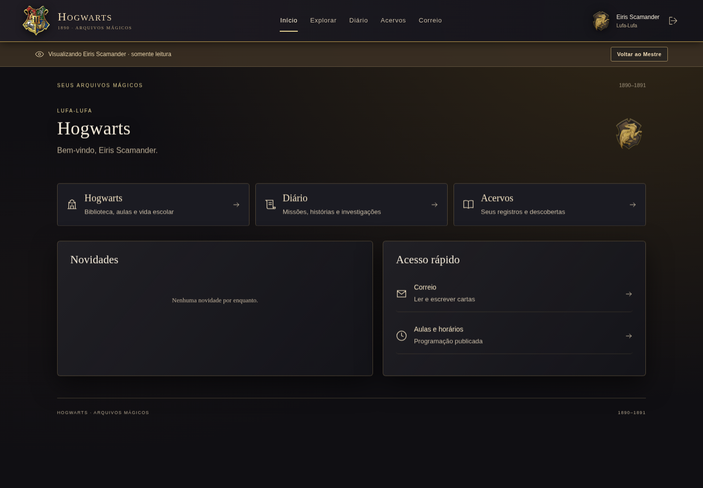
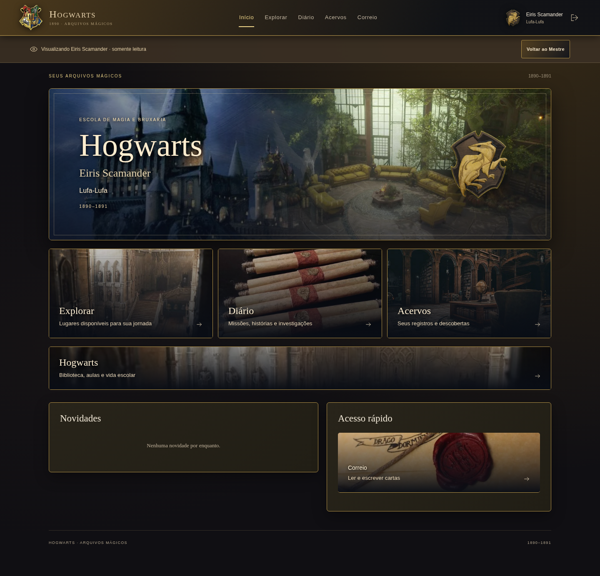
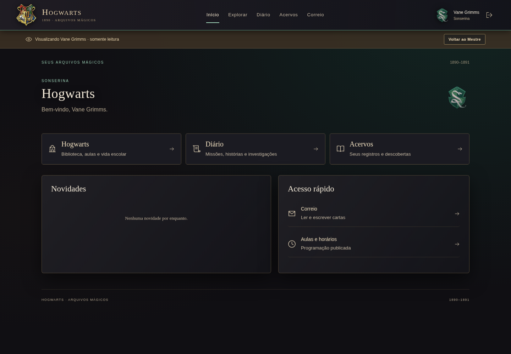
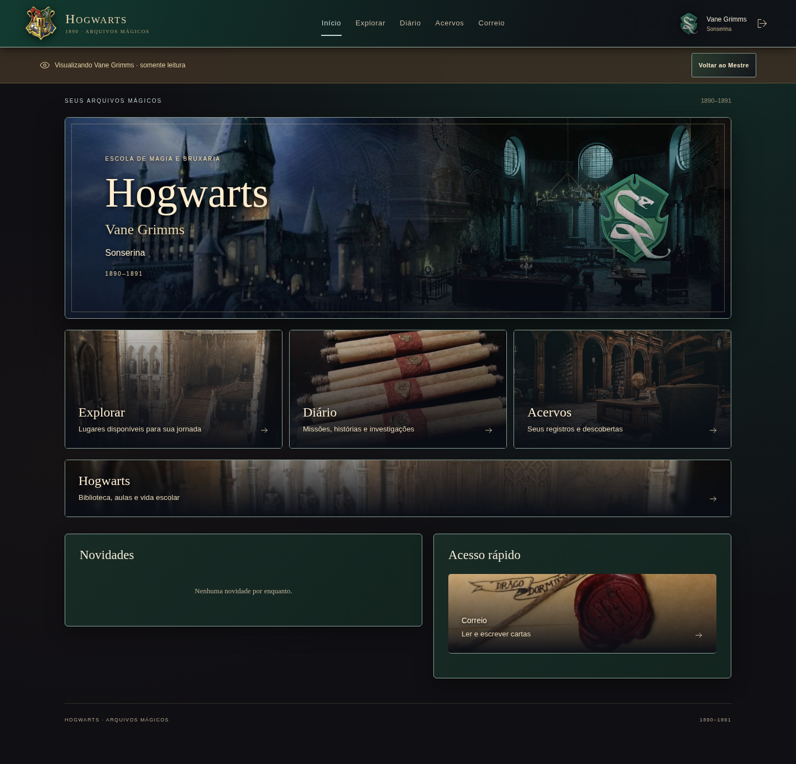
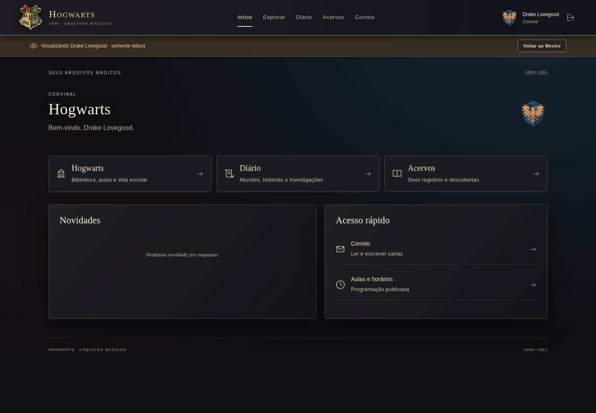
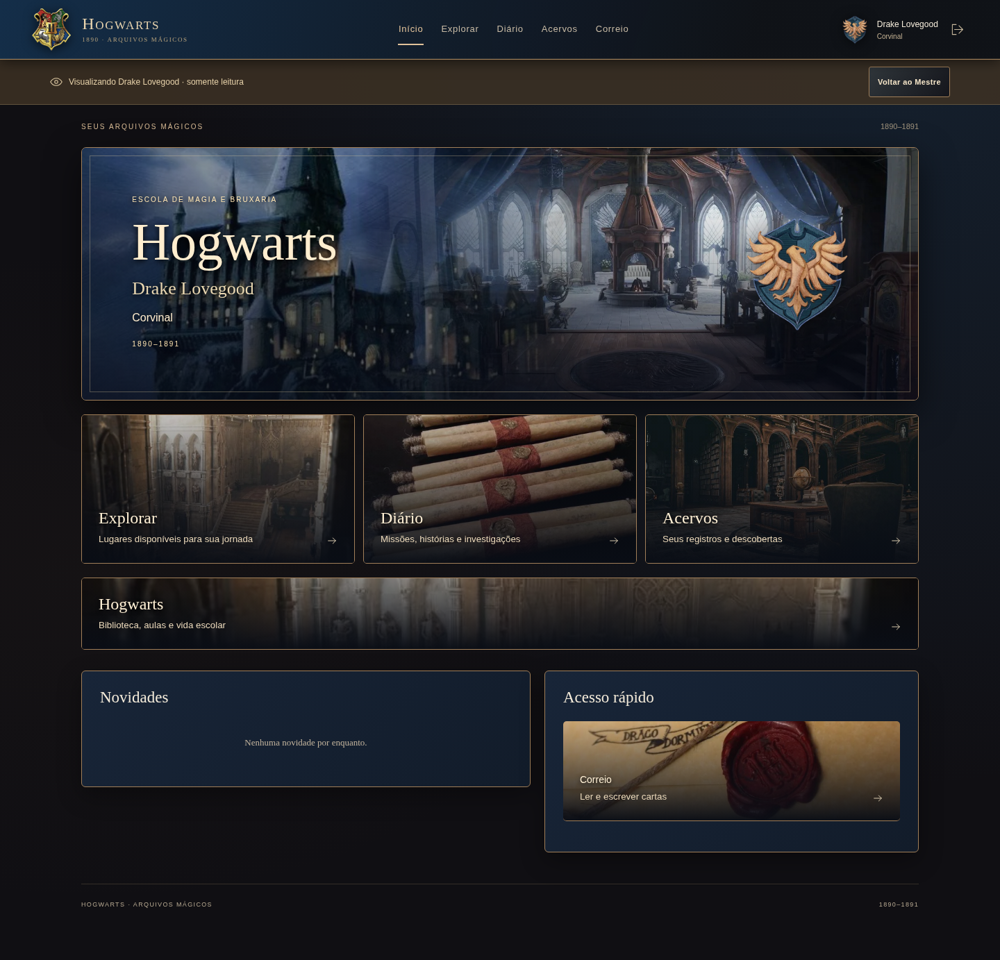

# Comparação visual da restauração

Capturas reais do aplicativo, com bancos locais descartáveis para QA. Não representam inspeção do banco de produção. Nenhum personagem, livro, missão ou aviso de teste foi incluído na campanha remota. As cenas e brasões são os arquivos aprovados, sem edição nem geração por IA.

[Referência V4 fornecida pelo Mestre](screenshots/restauracao/referencia-v4.png). A composição e a atmosfera foram recuperadas; os destinos atuais permanecem Explorar, Diário, Acervos e Correio, com Hogsmeade dentro da exploração autorizada.

| Casa / estudante | Base local d60be9f | Restauração desktop | Mobile real 390px |
|---|---|---|---|
| Grifinória — Atlas |  |  | [Abrir captura](screenshots/restauracao/mobile-atlas.png) |
| Lufa-Lufa — Eiris |  |  | [Abrir captura](screenshots/restauracao/mobile-eiris.png) |
| Sonserina — Vane |  |  | [Abrir captura](screenshots/restauracao/mobile-vane.png) |
| Corvinal — Drake |  |  | [Abrir captura](screenshots/restauracao/mobile-drake.png) |

Darius também foi verificado na Grifinória: [desktop](screenshots/restauracao/desktop-darius.png) e [390px](screenshots/restauracao/mobile-darius.png).

[Minhas Criações — desktop](screenshots/restauracao/criacoes-desktop.png) · [Minhas Criações — 390px](screenshots/restauracao/criacoes-mobile.png) · [Salão Comunal e mural autorizado — 390px](screenshots/restauracao/sala-comunal-mobile.png).

O Mestre mantém aparência administrativa neutra; a prévia assume o tema do estudante escolhido. Os registros RETOMAR e o mural mostrados nas capturas administrativas são fixtures temporárias para provar persistência e filtragem, não conteúdo canônico.

A matriz de funcionalidades, autorização, arquivos preservados e critérios de verificação está em [RESTAURACAO-UX.md](RESTAURACAO-UX.md).
