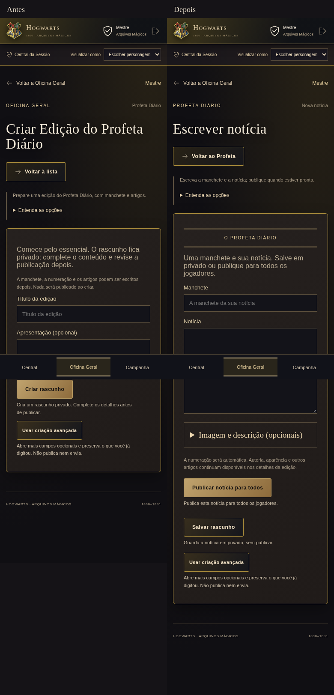
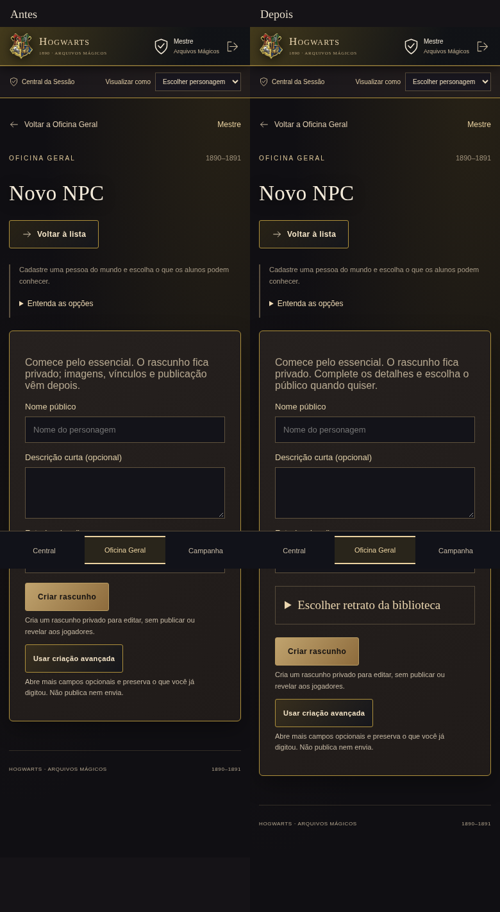

> Registro histórico da primeira entrega. O escopo foi ampliado e concluído nas 25 áreas: [relatório atual](REVISAO_COMPLETA_25.md). As limitações de escopo abaixo descrevem somente aquela primeira etapa.

# Simplicidade visual — NPC e Profeta

Entrega local na branch `feat/simplicidade-visual-npc-profeta`, baseada em `83f404c27c5d9ad2cd97775f7419d478e7dcf63b` (`feat/v6-4-revisao-completa`). A `main` remota contém somente o commit de inicialização vazio. Nenhum merge, push ou deploy foi feito.

## Escopo e mapa

Esta entrega conclui a **primeira etapa expressamente definida no briefing**: criar NPC e escrever notícia do Profeta, com seus atalhos e ajuda. Não representa a implementação integral das 25 revisões. O briefing determina comparação visual e revisão do Mestre antes de ampliar o padrão aos demais módulos.

- Interface em `public/`: portal, Explorar, Diário, acervos, Central do Mestre e editores. Os dois fluxos usam `quick-create.js`; NPC utiliza `npcs.js` e Profeta utiliza o editor genérico `content.js`.
- Node 24 + TypeScript; SQLite local, ou libSQL e armazenamento remoto opcionais. Sem substituição de stack.
- Autorização no servidor, projeções por jogador, arquivos privados, revisões e histórico existentes foram mantidos.
- Nenhum banco de campanha, upload de usuário ou `.env` existia neste checkout. Toda validação autenticada usou fixtures descartáveis. A instância local de desenvolvimento usa `/workspace/hogwarts-development`.
- Sem migrations novas, importação, exclusão ou atualização de registros legados. Os testes de backup/recuperação passaram; isso não constitui validação sobre um banco real não fornecido.

## Resultado

**NPC:** nome, descrição e foto continuam na criação curta; agora é possível escolher arquivo já enviado e informar ALT sem sair do editor. Rascunho permanece privado. Casa, vínculos, segredos, público, revelações, histórico e prévia não foram removidos. A publicação continua mostrando os destinatários efetivos e exigindo confirmação.

**Profeta:** manchete + notícia → publicar para todos ou salvar em privado. A ação informa explicitamente o público global, sem calendário obrigatório. Imagem por upload ou biblioteca, com ALT exigido quando presente. A numeração automática é atribuída no servidor dentro da transação, respeitando números manuais existentes. O editor mantém texto principal acessível; outros artigos, autoria, notas, modelos e detalhes continuam disponíveis. Abrir o avançado conserva texto, imagem e ALT. Se publicar falhar depois de salvar, o rascunho é preservado e o erro informa esse estado.

O atalho da Central passou de “Nova edição do Profeta” para “Escrever notícia do Profeta”. A ajuda e as legendas dos botões refletem a publicação direta.

## Evidência visual

Baseline capturado **antes** das alterações, na mesma base e com fixtures equivalentes. Desktop 1440 × 1000 e celular 390 × 844, página inteira: Início, Explorar, Diário, Biblioteca, novo NPC, nova missão, Profeta e Central. Há 16 imagens antes e 16 depois, mais quatro comparações lado a lado.

| Fluxo | Desktop | Celular |
| --- | --- | --- |
| NPC | [Antes/depois](screenshots/simplicidade/npc-desktop-comparacao.png) | [Antes/depois](screenshots/simplicidade/npc-mobile-comparacao.png) |
| Profeta | [Antes/depois](screenshots/simplicidade/profeta-desktop-comparacao.png) | [Antes/depois](screenshots/simplicidade/profeta-mobile-comparacao.png) |

A inspeção preservou brasão, fundo escuro, dourados, tipografia serifada, bordas e navegação existentes. O Profeta ganhou cabeçalho de jornal com borda dupla, sem trocar a identidade. O baseline já usava cards escuros nos formulários, ajuda recolhível e barra inferior fixa no celular; não são alterações desta entrega. Não foram constatados bloqueios visuais nos dois fluxos testados. A preferência estética final permanece com o Mestre.

[Comparação de pixels das telas de contexto](screenshots/simplicidade/comparacao.json): Explorar, Diário, Biblioteca e missão ficaram idênticos nas duas larguras. A Central muda no texto do atalho do Profeta; o Início desktop teve diferença mínima de renderização (15 canais de cor), com as mesmas dimensões. Essa comparação é auxiliar, não aprovação estética automática.

Reproduzir capturas: `npm run build && node scripts/capture-simplicidade.mjs after`. O script usa fixtures e as remove no final; não captura a campanha real. Para reproduzir o baseline, execute a captura na base indicada, com o script disponível fora do checkout ou copiado para ela, antes de aplicar a alteração.

## Validação executada

| Verificação | Resultado |
| --- | --- |
| `npm ci` com lockfile existente | Sucesso, sem alteração do lockfile |
| `npm run build` | TypeScript, bundle e 42 assets WebP aprovados |
| `npm run lint` | Sucesso |
| `npm test` | 195 aprovados; 0 falhas, skips ou testes pendentes |
| `npm run test:cloud` | 195 aprovados via SDK libSQL com arquivo local; não testa Turso/Blob reais |
| Playwright: simplicidade, npc-publication, journal, publication-drafts e quick-create | 11 aprovados; 0 falhas |
| Axe WCAG A/AA e 2.1 AA nas novas telas | Sem violações nos casos auditados |
| Servidor real via `npm start` | `/entrar`: 200; contexto administrativo sem sessão: 401 |
| `git diff --check` | Sem erros |

Os cenários incluem texto e foto preservados ao abrir avançado, leitura autorizada por jogadores, rascunho invisível, edição sem mudar publicação anterior, falha simulada de publicação sem perda de conteúdo, retrato privado, concorrência da numeração e publicação sem ano letivo. A suíte existente também verifica segredos, backups, restauração e permissões por personagem/grupo. O conjunto completo de E2E de todos os módulos não foi executado.

## Arquivos alterados

- `public/quick-create.js`: formulários curtos, reaproveitamento de retrato e transferência ao avançado.
- `public/content.js`: envio/publicação da notícia e organização do editor.
- `src/content.ts`: atribuição transacional do número.
- `src/journal.ts`: ano letivo opcional no Profeta.
- `public/style.css`: cabeçalho da composição e tamanho do texto.
- `public/action-captions.js`, `public/office-help.js`, `public/creations.js`: textos e atalho coerentes.
- `tests/journal.test.mjs`, `tests/simplicidade.e2e.spec.mjs`, `tests/publication-drafts.e2e.spec.mjs`, `playwright.config.mjs`: regressão, integração e navegador.
- `scripts/capture-simplicidade.mjs`, este relatório e `docs/screenshots/simplicidade/`: evidências e reprodução.

## Ambiente e reversão

`install_script` e `start_skill` foram salvos no rascunho da configuração do ambiente. Incluem instalação, build, diretório de trabalho, inicialização, verificações e uso do checkout existente sem worktree. Nenhum segredo adicional é necessário para o desenvolvimento local. O salvamento não publica o ambiente: revisar/salvar nas configurações e publicar são ações posteriores do produto. Restauração em uma nova tarefa não foi testada.

As alterações permanecem locais e revisáveis, sem commit ou push. Para rollback, preserve primeiro quaisquer alterações posteriores do usuário e reverta somente os arquivos desta entrega para a base indicada. Não restaure nem apague banco ou mídia: nenhuma migração foi introduzida e os formatos legados permanecem aceitos. Edições novas que usem ano letivo ausente precisam receber esse vínculo caso se volte a uma versão antiga que o exigia.

As demais oficinas e a retirada global de Calendário/Eventos/Horários seguem fora desta etapa; sua presença legada não foi eliminada nem ocultada globalmente. Não ampliar a mudança nem realizar merge/deploy antes da revisão visual prevista no briefing.
